  

  

  
  
  
  

## 👨‍💻 About Me

I'm a **Frontend Engineer (SDE II) at Bajaj Finserv Health** in Pune, with **3.8 years** of building production React and Next.js applications for enterprise B2B health and insurance platforms. I care about UI architecture that scales across teams, interfaces that stay fast, and code that's easy to change.

- 🏗️ **Microfrontends at scale:** Module Federation, shared dependencies, and reusable component systems across products
- 📈 **Production impact:** frontends handling **11,000+ claim submissions a day**, and Lighthouse scores raised **from ~60 to 95**
- 🤖 **AI voice agents:** campaign and analytics UIs for voicebot workflows processing **125K+ calls a month**
- 🎨 **Canvas-based image editing tools** for in-product workflows

Work code is proprietary. The projects below are personal ones you can read in full.

## 🎯 Current Focus

- 🚀 Building a **PaaS platform for AI agents** at work
- ⚡ Performance engineering: Core Web Vitals, bundle budgets, and SSR/SSG trade-offs
- 🧩 Scalable frontend architecture with microfrontends and Module Federation

## 🛠️ Tech Stack

<table>
  <tr>
    <td align="center" width="130"><b>Frontend</b></td>
    <td>
      
    </td>
  </tr>
  <tr>
    <td align="center"><b>State Management</b></td>
    <td>
      
      
      
    </td>
  </tr>
  <tr>
    <td align="center"><b>UI Libraries</b></td>
    <td>
      
      
      
    </td>
  </tr>
  <tr>
    <td align="center"><b>Backend &amp; APIs</b></td>
    <td>
      
      
    </td>
  </tr>
  <tr>
    <td align="center"><b>Architecture</b></td>
    <td>
      
      
    </td>
  </tr>
  <tr>
    <td align="center"><b>Testing</b></td>
    <td>
      
      
    </td>
  </tr>
  <tr>
    <td align="center"><b>Tools</b></td>
    <td>
      
    </td>
  </tr>
</table>

## 📊 Developer Rating

  

<i>These are my own self-assessment scores, not official or independently verified ratings.</i>

## 🚀 Featured Projects

<table>
  <tr>
    <td valign="top" width="50%">
      <h3>🎧 <a href="https://github.com/Adarsh-kushwaha/baaza">Baaza</a></h3>
      
An installable, Spotify-style PWA that brings 100+ independent Indian playlist and internet-radio sites into one app.

      <ul>
        <li>Server-side CSP <code>frame-ancestors</code> / <code>X-Frame-Options</code> check with a unit-tested parser</li>
        <li>Library-free state: a typed <code>localStorage</code> store via <code>useSyncExternalStore</code>, synced across tabs</li>
        <li>Offline service worker and Capacitor shells for background audio</li>
      </ul>
      

        
        
        
        
      

      

        <a href="https://baaza.vercel.app"><b>🌐 Live demo</b></a> ·
        <a href="https://github.com/Adarsh-kushwaha/baaza"><b>📂 Code</b></a>
      

    </td>
    <td valign="top" width="50%">
      <h3>🧠 <a href="https://github.com/Adarsh-kushwaha/revigion">Revigion</a></h3>
      
A spaced-repetition revision tracker that schedules 5 revisions per question and sends push reminders in your timezone.

      <ul>
        <li>Timezone-correct scheduling done in calendar space, so it's safe across DST and UTC day boundaries</li>
        <li>Runtime-agnostic dispatcher: unit-tested in Vitest, run in a Deno Edge Function</li>
        <li>Optimistic UI with rollback and a stale-while-revalidate client cache</li>
      </ul>
      

        
        
        
        
      

      

        <a href="https://github.com/Adarsh-kushwaha/revigion"><b>📂 Code</b></a>
        <!-- Add a live demo link here once deployed: · <a href="https://..."><b>🌐 Live demo</b></a> -->
      

    </td>
  </tr>
</table>

<!--
  ➕ Add your next project by copying a <td> block above. Only add links that exist.
-->

## 📈 GitHub Analytics

  
  

  

### 🐍 Contribution Activity

  <picture>
    <source media="(prefers-color-scheme: dark)" srcset="https://raw.githubusercontent.com/Adarsh-kushwaha/Adarsh-kushwaha/output/github-snake-dark.svg" />
    <source media="(prefers-color-scheme: light)" srcset="https://raw.githubusercontent.com/Adarsh-kushwaha/Adarsh-kushwaha/output/github-snake.svg" />
    
  </picture>

The snake is regenerated daily by a GitHub Action from my real contribution graph. If any card above fails to load, the full contribution calendar is just below this README.

## 🤝 Connect With Me

  &nbsp;
  &nbsp;
  &nbsp;
  

  

